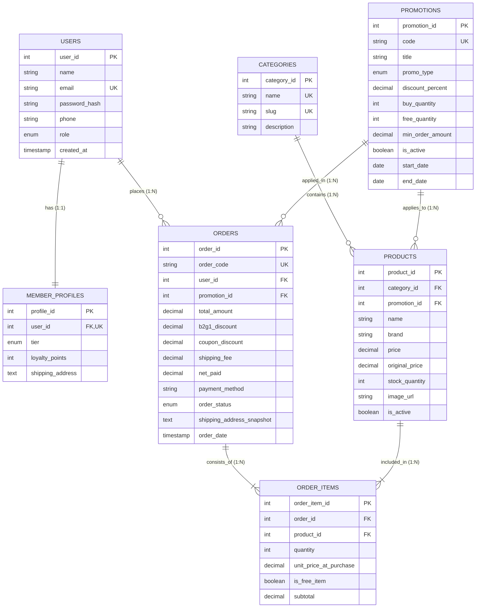

# SPORT.CPE — Database Schema & 7-Step Relational Mapping Report
## เอกสารประกอบรายงานโครงงาน วิชา 261342 Database Systems
### ภาควิชาวิศวกรรมคอมพิวเตอร์ มหาวิทยาลัยเชียงใหม่ (CPE CMU)

---

## 📌 1. บทนำและขอบเขตของระบบ (System Scope & Objectives)

**SPORT.CPE** เป็นเว็บแอปพลิเคชันระบบพาณิชย์อิเล็กทรอนิกส์ขนาดย่อม (Mini E-commerce Web Application) สำหรับจำหน่ายอุปกรณ์กีฬาแท้ 100% ครอบคลุมหลากหลายประเภท เช่น วิ่ง, แบดมินตัน, บาสเกตบอล, ฟุตบอล, วอลเลย์บอล, แคมป์ปิ้ง, ฟิตเนส และว่ายน้ำ

ระบบได้รับการออกแบบโครงสร้างฐานข้อมูลเชิงสัมพันธ์ (Relational Database) เพื่อรองรับ 7 ฟังก์ชันหลัก (Core Features) และ 3 ฟังก์ชันเสริมที่ได้รับมอบหมาย (Extra Features) ดังนี้:
1. **Core Feature 1 (Home Page)**: แสดงรายการสินค้าเด่นและแบนเนอร์โปรโมชัน
2. **Core Feature 2 (Products Page)**: แคตตาล็อกสินค้าพร้อมการกรองหมวดหมู่กีฬาและแบรนด์
3. **Core Feature 3 & 4 (Register & Login)**: ระบบสมาชิกและแยกบทบาท (Role) ระหว่างสมาชิกลูกค้า (Member) กับผู้ดูแลระบบ (Admin)
4. **Core Feature 5 (Member Profile)**: แสดงข้อมูลส่วนตัว, ระดับสมาชิก (Loyalty Tier), และประวัติคำสั่งซื้อ
5. **Core Feature 6 (Cart)**: ระบบรถเข็นสินค้า
6. **Core Feature 7 (Checkout)**: ระบบสรุปคำสั่งซื้อและการชำระเงิน
7. **Extra Feature 3.1 (Promotion Discount / Coupon)**: ระบบคำนวณส่วนลดจากคูปอง (เช่น `SAVE15` ลด 15%, `SPORT10` ลด 10%)
8. **Extra Feature 3.2 (Promotion Buy X Get Y)**: ระบบโปรโมชันซื้อ 2 แถม 1 (Buy 2 Get 1 Free) คำนวณของแถมให้อัตโนมัติในตะกร้า
9. **Extra Feature 3.3 (Admin Dashboard)**: แผงควบคุมสำหรับปรับปรุงสต็อกสินค้าและเปลี่ยนสถานะการจัดส่งพัสดุ (`Paid` $\to$ `Shipped` $\to$ `Delivered`)

---

## 📐 2. แผนภาพความสัมพันธ์เชิงแนวคิด (Conceptual ER Diagram)

---

## 🔄 3. ขั้นตอนการแปลง ER สู่ Relational Schema (7-Step Mapping Algorithm)

การแปลง Entity-Relationship Model ไปเป็น Relational Schema ได้ปฏิบัติตามมาตรฐานขั้นตอน 7 ขั้นตอน (ตามเนื้อหาบรรยาย Chapter 9) อย่างเคร่งครัด:

### Step 1: Mapping of Regular Entity Types
สร้าง Relation สำหรับ Regular Entity ทุกตัว โดยเลือก Attribute ที่เป็น Key มาเป็น Primary Key (PK):
* **`users`**(`user_id` [PK], `name`, `email`, `password_hash`, `phone`, `role`, `created_at`, `updated_at`)
* **`categories`**(`category_id` [PK], `name`, `slug`, `description`)
* **`promotions`**(`promotion_id` [PK], `code`, `title`, `promo_type`, `discount_percent`, `buy_quantity`, `free_quantity`, `min_order_amount`, `is_active`, `start_date`, `end_date`)
* **`products`**(`product_id` [PK], `name`, `brand`, `price`, `original_price`, `stock_quantity`, `image_url`, `is_active`, `created_at`)

---

### Step 2: Mapping of Weak Entity Types
* ในระบบนี้ ไม่มี Weak Entity ชนิด Identify Owner แบบพึ่งพา Dependent Key บริสุทธิ์ เนื่องจากตารางรายละเอียดสินค้าในบิล (`order_items`) ถูกออกแบบตาม Step 5 (M:N Relationship) โดยมี Surrogate Key `order_item_id` ร่วมกับ Foreign Keys

---

### Step 3: Mapping of Binary 1:1 Relationship Types
* **ความสัมพันธ์ระหว่าง `users` และ `member_profiles` (1:1)**:
  * บัญชีผู้ใช้ 1 บัญชี มีโปรไฟล์สมาชิกและแต้มสะสมได้เพียง 1 โปรไฟล์
  * **วิธีการแปลง (Foreign Key Approach)**: นำ PK ของ `users` คือ `user_id` ไปเป็น Foreign Key ในตาราง `member_profiles` และกำหนดเงื่อนไข `UNIQUE` เพื่อรักษากฎความสัมพันธ์แบบ 1:1
  * **ผลลัพธ์**: `member_profiles`(`profile_id` [PK], `user_id` [FK, UNIQUE], `tier`, `loyalty_points`, `shipping_address`)

---

### Step 4: Mapping of Binary 1:N Relationship Types
นำ PK ของฝั่ง 1 (One-side) ไปเป็น Foreign Key (FK) ในฝั่ง N (Many-side):
1. **`categories` (1) $\to$ `products` (N)**:
   * นำ `category_id` ไปใส่ในตาราง `products`
2. **`promotions` (1) $\to$ `products` (N)**:
   * นำ `promotion_id` ไปใส่ในตาราง `products` (แบบ Nullable เพื่อระบุว่าสินค้ารายการใดเข้าร่วมโปร ซื้อ 2 แถม 1)
3. **`users` (1) $\to$ `orders` (N)**:
   * ลูกค้า 1 คนสามารถมีได้หลายออเดอร์ จึงนำ `user_id` ไปเป็น FK ในตาราง `orders`
4. **`promotions` (1) $\to$ `orders` (N)**:
   * ออเดอร์ 1 ใบสามารถใช้คูปองส่วนลด (Coupon Code) ได้ จึงนำ `promotion_id` ไปเป็น FK ในตาราง `orders`

---

### Step 5: Mapping of Binary M:N Relationship Types
* **ความสัมพันธ์ระหว่าง `orders` และ `products` (M:N)**:
  * ออเดอร์ 1 ใบมีสินค้าได้หลายชนิด และสินค้าแต่ละชนิดสามารถอยู่ในหลายออเดอร์
  * **วิธีการแปลง**: สร้าง Relation ใหม่ชื่อ **`order_items`** เพื่อเป็นสะพานเชื่อม
  * ดึง PK ของทั้ง 2 ตาราง (`order_id` และ `product_id`) เข้ามาเป็น Foreign Keys
  * เพิ่ม Relationship Attributes: `quantity`, `unit_price_at_purchase`, `is_free_item`, และ `subtotal`
  * **ผลลัพธ์**: `order_items`(`order_item_id` [PK], `order_id` [FK], `product_id` [FK], `quantity`, `unit_price_at_purchase`, `is_free_item`, `subtotal`)

---

### Step 6: Mapping of Multivalued Attributes
* Attributes ในระบบทั้งหมดเป็น Single-valued (ที่อยู่จัดส่ง, เบอร์โทรศัพท์หลัก) จึงไม่มี Multivalued Table เพิ่มเติม

---

### Step 7: Mapping of N-ary Relationship Types / Specialization
* ระบบจัดการบทบาทผู้ใช้งาน (User Roles: Member vs. Admin) ใช้ Disjoint Single Table Design ด้วยคอลัมน์ `role ENUM('member', 'admin')` ในตาราง `users` เพื่อลด Overhead ในการ Join และเพิ่มความเร็วในการ Query ตรวจสอบสิทธิ์

---

## 🛡️ 4. การออกแบบป้องกันความผิดปกติของข้อมูล (Anti-Anomaly Design)

### 1. ปัญหา Historical Price Drift Anomaly
* **ปัญหา**: หากตาราง `order_items` ดึงราคาจาก `products.price` ตลอดเวลา เมื่อ Admin ทำการปรับราคาสินค้าในอนาคต (เช่น ไม้แบดขึ้นราคาจาก ฿6,890 เป็น ฿7,500) ข้อมูลยอดรวมในออเดอร์ย้อนหลังเมื่อ 2 ปีก่อนจะเปลี่ยนแปลงตามไปด้วย ทำให้งบการเงินและประวัติบัญชีลูกค้าผิดเพี้ยนทันที
* **การแก้ไข (Historical Price Freeze)**: ตาราง `order_items` มีการจัดเก็บคอลัมน์ `unit_price_at_purchase` ซึ่งจะบันทึกราคาจริง ณ วินาทีที่ลูกค้าทำการสั่งซื้ออย่างถาวร ป้องกัน Modification Anomaly ได้ 100%

### 2. ปัญหา Shipping Address Anomaly
* **ปัญหา**: หากลูกค้าแก้ไขที่อยู่จัดส่งในหน้าโปรไฟล์ (`member_profiles.shipping_address`) พัสดุของคำสั่งซื้อเก่าที่จัดส่งไปแล้วจะเปลี่ยนที่อยู่ตาม
* **การแก้ไข (Address Snapshot)**: ในตาราง `orders` มีการเก็บคอลัมน์ `shipping_address_snapshot` เพื่อ Freeze ข้อมูลที่อยู่ปลายทางของออเดอร์นั้นๆ ไว้เป็นหลักฐานอย่างสมบูรณ์

---

## 📋 5. การตรวจสอบความปกติ (Normalization Check)

1. **First Normal Form (1NF)**:
   * ทุก Attribute มีค่าเป็น Atomic Value (ไม่เป็น Composite และไม่มี Multivalued)
   * มี Primary Key กำหนดไว้อย่างชัดเจนในทุกตาราง
2. **Second Normal Form (2NF)**:
   * อยู่ใน 1NF เรียบร้อย
   * ไม่มี Partial Functional Dependency (ทุก Non-key Attribute ขึ้นตรงต่อ Primary Key ทั้งหมด)
3. **Third Normal Form (3NF)**:
   * อยู่ใน 2NF เรียบร้อย
   * ไม่มี Transitive Dependency ($X \to Y$ และ $Y \to Z$ โดยที่ $Y$ ไม่ใช่ Candidate Key)

---

## 🚀 6. การนำไปใช้งานจริง (Deployment Instructions)

1. **สำหรับ DBeaver / MySQL Server**:
   * นำไฟล์ [`database/schema.sql`](file:///c:/CPE%20Season%203/Demo/subject/Database-Lecture/project/sport-cpe-app/database/schema.sql) ไป Execute Script เพื่อสร้างตารางทั้งหมด
   * นำไฟล์ [`database/seed_data.sql`](file:///c:/CPE%20Season%203/Demo/subject/Database-Lecture/project/sport-cpe-app/database/seed_data.sql) ไป Execute Script เพื่อกรอกข้อมูลทดสอบ
2. **สำหรับ Laravel Artisan CLI**:
   * รันคำสั่ง `php artisan migrate` โดยไฟล์ Migration จะอยู่ที่ [`database/migrations/2026_10_23_000001_create_sport_cpe_tables.php`](file:///c:/CPE%20Season%203/Demo/subject/Database-Lecture/project/sport-cpe-app/database/migrations/2026_10_23_000001_create_sport_cpe_tables.php)
